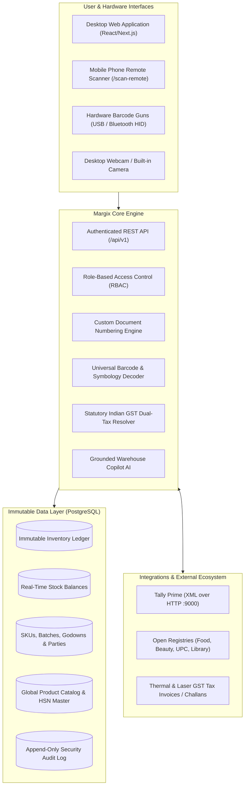

# Margix IMS — Enterprise Inventory & Warehouse Management System
## Chapter 0: System Overview, Architecture & Value Proposition

---

### 1. What is Margix IMS?

**Margix IMS** is a modern, high-performance, Indian GST-compliant enterprise Inventory and Warehouse Management System. Built with Next.js (App Router), React, TypeScript, and PostgreSQL with Prisma, Margix IMS is engineered specifically for manufacturing units, distributors, wholesalers, retail chains, and multi-location warehouses in India and global markets.

Unlike traditional desktop software that locks data onto a single computer or clunky legacy ERPs with high latency, Margix IMS combines **sub-millisecond local in-memory processing**, an **immutable double-entry inventory ledger**, **universal hardware & mobile barcode scanning**, and **native Tally Prime ERP synchronization**.

---

### 2. Core Architectural Pillars

Margix IMS is architected on five non-negotiable operational principles:

#### 1. The Immutable Inventory Ledger is the Source of Truth
Stock balances are **never** manually overwritten or directly incremented/decremented in the database. Every movement of goods—whether a receipt, sale, inter-godown transfer, or physical count adjustment—generates an immutable record in `inventory_ledger` with a strictly enforced mathematical sign (`+` for IN, `-` for OUT). Current stock is a deterministic aggregate of this ledger. Database CHECK constraints and triggers guarantee that `SUM(ledger) = stock_balance` at all times, making inventory drift physically impossible.

#### 2. Native Indian Statutory GST Compliance
Margix IMS provides end-to-end statutory Indian GST calculations out of the box:
- Automatically detects **Intra-State** transactions (`CGST` + `SGST`) vs **Inter-State** transactions (`IGST`) by parsing the 2-digit state code from party GSTINs against the tenant's registered business state.
- Embedded official Indian GST Tariff Master seeded with official 4-digit and 8-digit **HSN codes** and statutory tax rates (`0.00%`, `5.00%`, `12.00%`, `18.00%`, `28.00%`).
- Generation of compliant GST Tax Invoices, Delivery Challans, and E-Way bill-ready dispatch summaries.

#### 3. Universal Multi-Symbology Barcode Support
Supports 15 standard barcode formats across consumer goods, pharmaceuticals, books, and heavy industrial hardware:
- `EAN-13`, `UPC-A`, `CODE-39`, `EAN-8`, `GS1-128`, `GS1-DATAMATRIX`, `GTIN-14`, `ITF-14`, `ISBN-10`, `ISBN-13`, `ISSN`, `JAN`, `PZN`, `ASIN`, and `FNSKU`.
- **Carton Level Recognition**: Automatically extracts inner consumer unit EAN-13 codes from master shipping cartons (`GTIN-14` / `ITF-14`) to match warehouse stock immediately.
- Zero-cost hardware scanning: Turn any mobile smartphone into a high-speed wireless barcode reader using `/scan-remote` without installing apps.

#### 4. Frictionless Tally Prime Sync
For businesses running accounting on Tally Prime, Margix IMS includes a direct bidirectional XML-over-HTTP bridge:
- Synchronizes inventory stock items, units of measure, and godowns.
- Posts Purchase Vouchers, Sales Vouchers, Receipt Notes, and Rejections directly to Tally.
- Prevents double entry while allowing warehouse teams to operate on modern mobile/web interfaces.

#### 5. Strict Role-Based Access Control (RBAC) & Audit Integrity
Every action (who logged in, who created a SKU, who approved an invoice, who adjusted stock) is permanently recorded in an append-only `audit_log` table with the actor's ID, timestamp, IP address, and complete before/after data diffs. Critical stock operations enforce maker-checker separation to prevent fraud.

---

### 3. Module & Capability Breakdown

| Module | Primary Route | Key Capabilities |
| :--- | :--- | :--- |
| **Master Data** | `/masters/*` | SKUs, Multi-UOM with conversion ratios, Categories, Godowns, Customers, Suppliers, HSN Master, CSV Bulk Import. |
| **Universal Scanner** | `/scan-remote` & in-app | 15 barcode types, Modulo 10/11 checksum validation, wireless phone reader, desktop camera, instant auto-fill. |
| **Purchasing & Inward** | `/purchase-orders`, `/grns` | Vendor POs, Goods Receipt Notes, batch number & expiry date capture, rejection tracking, Purchase Returns (Debit Notes). |
| **Sales & Outward** | `/invoices`, `/dispatches` | GST Tax Invoices, multi-currency/multi-tax lines, warehouse dispatch packing verification, Sales Returns (Credit Notes). |
| **Warehouse Operations** | `/stock`, `/transfers`, `/adjustments` | Multi-godown stock balances, inter-warehouse transfers, cycle count adjustments, opening inventory loading. |
| **Audit & Ledger** | `/ledger`, `/audit` | Immutable stock movement ledger, system-wide security audit trail with full before/after JSON diffs. |
| **Reports & Health** | `/reports/*`, `/analytics` | Dead stock alerts (>90 days), slow-moving stock, stock valuation, inventory turnover ratio, category analytics. |
| **Tally Prime Sync** | `/tally` | Master sync, voucher sync, bidirectional XML bridge, sync logs, error remediation. |
| **Copilot AI** | In-app sidecar | Warehouse AI assistant for voice/text stock queries, barcode identification, HSN lookup, and cheat sheets. |
| **System Administration**| `/admin/*` | User management, RBAC (`ADMIN`, `MANAGER`, `OPERATOR`, `VIEWER`), custom document numbering series, operational checklists. |

---

### 4. Technical Specifications & Deployment Stack

- **Frontend**: Next.js 16 (App Router), React 19, Tailwind CSS, Lucide Icons, Radix UI primitives.
- **Backend**: Node.js 22 LTS, Next.js Route Handlers (`/api/v1/*`), Zod runtime schema validation.
- **Database**: PostgreSQL 16+ (Flexible Server on Azure / Local Container), Prisma ORM with versioned SQL migrations.
- **Barcode Engine**: `@zxing/library`, `barcode-detector` ponyfill, custom industrial mathematical parser (`industrial-barcode.ts`).
- **Authentication**: Session cookie authentication with scrypt password hashing, session TTL management, and brute-force lockout protection.
- **Containerization**: Multi-stage production `Dockerfile` running on `node:22-bookworm-slim` with standalone Next.js server.
