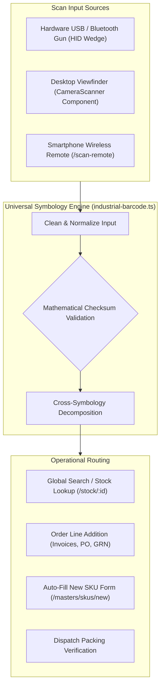
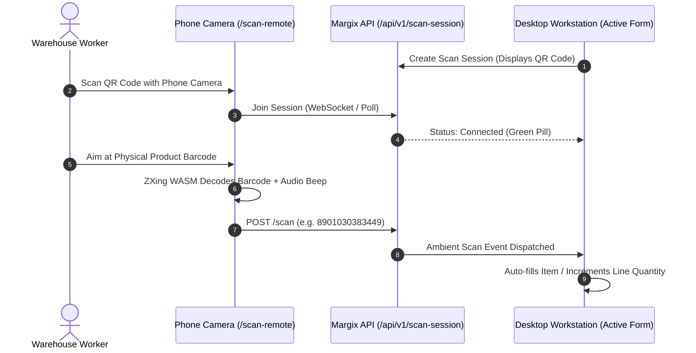
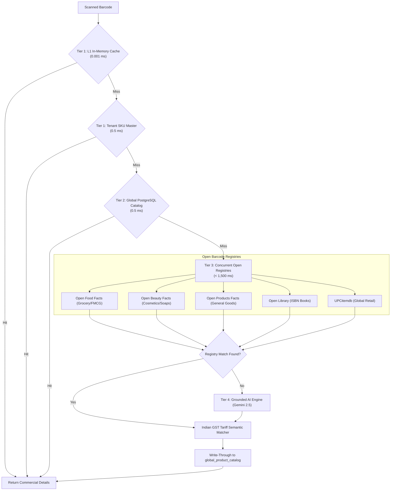

# Margix IMS — Enterprise Inventory & Warehouse Management System
## Chapter 2: Universal Barcode & Scanner Engine

---

### 1. Overview of the Barcode Architecture

Margix IMS is designed from the ground up for high-velocity physical operations. Whether in a warehouse picking aisle, an incoming dispatch loading dock, or a retail POS counter, workers can scan items using **any hardware scanner**, **a desktop webcam**, or **any smartphone camera wirelessly**.

---

### 2. Supported Symbologies & Standards (15 Formats)

Margix IMS natively decodes, verifies, and cross-converts 15 global standard symbologies:

| Symbology | Format | Checksum Algorithm | Industry Sector | Conversion Rule |
| :--- | :--- | :--- | :--- | :--- |
| **`EAN-13`** | 13 numeric digits | GS1 Modulo 10 (weights 1 & 3) | Retail & consumer goods | Prepending `0` converts bidirectionally to UPC-A. |
| **`UPC-A`** | 12 numeric digits | GS1 Modulo 10 (weights 3 & 1) | Imported North American retail | Maps to EAN-13 by adding leading `0`. |
| **`CODE-39`** | Alphanumeric (`*ABC-123*`) | Self-checking; Mod 43 optional | Automotive, defense, aerospace | Automatically strips start/stop asterisks (`*`). |
| **`EAN-8`** | 8 numeric digits | GS1 Modulo 10 | Confectionery, cosmetics, small packs| Compact standalone retail identifier. |
| **`GS1-128`** | Variable alphanumeric | GS1 Application Identifier (AI) | Logistics, pharmaceuticals, chemicals| Parses `(01)` GTIN, `(10)` Batch, `(17)` Expiry, `(21)` Serial. |
| **`GS1-DataMatrix`**| 2D Matrix code | GS1 AI standard + Reed-Solomon | Medical devices, aerospace, pharma | Extracts multi-parameter lot numbers and expiration dates. |
| **`GTIN-14` / `ITF-14`**| 14 numeric digits | GS1 Modulo 10 | Wholesale master shipping cartons | Strips packaging indicator `1-8` to extract inner consumer `EAN-13`. |
| **`ISBN-13`** | 13 numeric (978/979) | GS1 Modulo 10 | Books & printed publications | Cross-converts to 10-digit ISBN for 978 prefix. |
| **`ISBN-10`** | 10 chars (0-9, X) | Modulo 11 ($\sum (11-i) \times d_i$) | Legacy books & literature | Converted to EAN-13 via `978` + 9 digits + GS1 check digit. |
| **`ISSN`** | 8 chars (`xxxx-xxxx`) | Modulo 11 ($\sum (9-i) \times d_i$) | Journals, newspapers, periodicals | Maps to EAN-13 (`977` + 7 digits + `00` + check digit). |
| **`JAN`** | 13 digits (prefix 45/49)| GS1 Modulo 10 | Japanese consumer imports | GS1 Japan country code subset of EAN-13. |
| **`PZN`** | 8 numeric (`PZN-xxxxxxx`)| Modulo 11 ($\sum i \times d_i$) | German & EU pharmaceuticals | Strips/adds prefix; matches Code 39 & GS1 DM AI 710. |
| **`ASIN`** | 10 alphanumeric (`B0...`) | Amazon format validation | Amazon marketplace products | Links internal merchant SKU to Amazon product catalog. |
| **`FNSKU`** | 10 alphanumeric (`X0...`) | Amazon fulfillment format | Amazon FBA warehouse tracking | Strips tracking headers; maps to merchant SKU. |
| **`CODE-128`** | Variable alphanumeric | Modulo 103 checksum | General industrial logistics | High-density internal inventory and part tracking. |

---

### 3. Wholesale Master Carton Recognition (`GTIN-14` / `ITF-14`)

Wholesale operations receive goods in corrugated master cases that contain multiple individual consumer items.
- The first digit of a 14-digit GTIN represents the **Packaging Indicator** (`1` = inner pack, `2` to `7` = master carton, `8` = pallet).
- Digits 2 through 13 represent the base trade item payload.
- Margix IMS automatically calculates the GS1 check digit for the base payload and extracts the **inner consumer unit EAN-13**.

#### Example:
1. Operator scans shipping carton: `18901234567897` (`GTIN-14`)
2. Margix identifies `1` as an outer carton indicator.
3. Automatically computes inner consumer unit: `8901234567890` (`EAN-13`).
4. In inventory, the system matches the existing SKU for the single consumer product while tagging the scan banner with `[GTIN-14] [Case Carton]`.

---

### 4. Wireless Smartphone Scanner (`/scan-remote`)

Margix IMS includes a built-in mobile scanning engine that transforms any smartphone into a wireless industrial barcode gun with **zero app installation**:

#### Key Capabilities of the Mobile Scanner:
1. **Battery-Saving Auto-Sleep**: Shuts down the camera sensor after 45 seconds of inactivity or when the phone screen locks. A simple tap wakes the camera instantly.
2. **Built-in Flashlight / Torch**: Includes an on-screen toggle to turn on the smartphone camera torch for dimly lit warehouse aisles.
3. **Double-Read Prevention (Cooldown)**: Enforces a 1,500ms software cooldown on identical barcodes to prevent unintentional duplicate scans of the same carton.
4. **Vibrational & Audio Feedback**: Emits an audible chime and haptic pulse upon successful decode.

---

### 5. Desktop Camera Scanner (`CameraScanner`)

For workstations equipped with a USB webcam or laptop camera:
- Accessible via the camera button on any barcode field.
- Displays a real-time viewfinder overlay with targeting brackets.
- Renders live symbology badges (`[EAN-13]`, `[UPC-A]`, `[GTIN-14]`, etc.) directly on top of the decoded stream.

---

### 6. Hardware USB / Bluetooth Barcode Guns

Margix IMS natively supports all standard USB and Bluetooth barcode scanners operating in **HID Keyboard Wedge mode**:
- Barcode guns type the scanned value into the focused input followed by an automatic `Enter` keypress (`\r` or `\n`).
- The `useBarcodeScanListener` hook listens for rapid keystroke sequences (under 50ms per character) and routes the scan to the active document editor even if the cursor is not explicitly focused inside the text input.

---

### 7. Multi-Tier Product Auto-Discovery Pipeline

When an unregistered barcode is scanned during SKU creation or invoice entry, Margix IMS resolves commercial metadata via a 4-tier pipeline:

#### Self-Learning Write-Through Persistence
Once an item is resolved via open registries or merchant entry:
- It is saved permanently to PostgreSQL `global_product_catalog`.
- The resolved statutory **HSN code**, **GST rate**, **Category**, and **UOM** are persisted under both the primary code and all secondary candidate representations (`UPC-A`, `EAN-13`, `GTIN-14`).
- All subsequent scans across all warehouses and workstations respond instantly from local database indexes (0.5ms) without making outbound internet calls.
