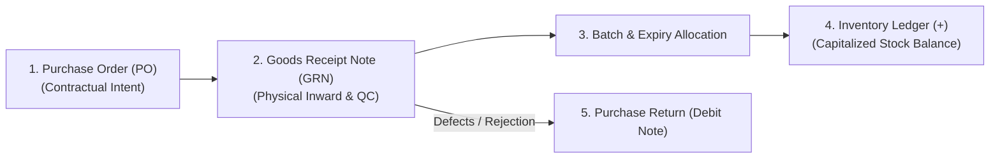
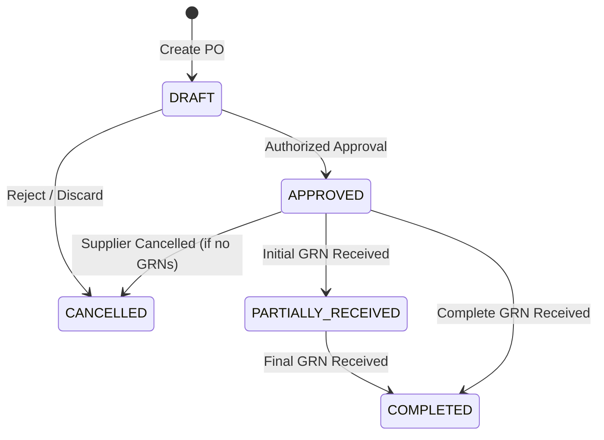
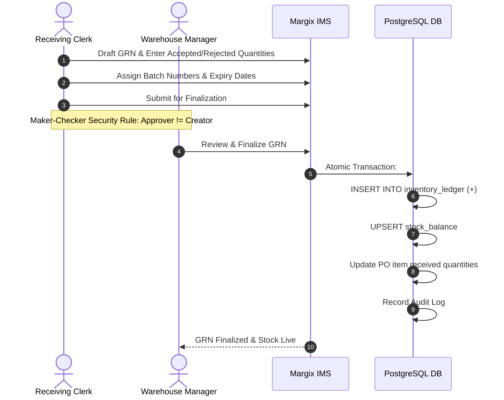

# Margix IMS — Enterprise Inventory & Warehouse Management System
## Chapter 3: Inbound Logistics & Purchasing Operations

---

### 1. Inbound Logistics Lifecycle

Inbound operations govern the procurement, physical receipt, quality inspection, batch tracking, and inventory capitalization of goods received from suppliers.

---

### 2. Purchase Orders (PO)

The Purchase Order (`/purchase-orders`) represents a legally binding commercial procurement document issued to a vendor.

#### PO Workflow & Status Transitions

#### Key Fields on Purchase Orders
- **PO Number (`number`)**: Auto-generated sequence (e.g. `PO-2026-00042`) or custom vendor reference.
- **Supplier (`supplierId`)**: Selected from registered supplier master.
- **Delivery Destination (`godownId`)**: Target receiving godown.
- **Order Lines**:
  - SKU selection with UOM and conversion factor.
  - Quantity ordered.
  - Unit purchase price (exclusive of GST).
  - Discount percentage or flat reduction.
  - Applicable GST rate (auto-populated from SKU / HSN master).
- **Tax Breakdown**: Automatically splits GST into **CGST + SGST** (for intra-state vendors) or **IGST** (for inter-state vendors).

---

### 3. Goods Receipt Notes (GRN)

The Goods Receipt Note (`/grns`) is the central warehouse document that acknowledges the arrival of physical stock. **Only a finalized GRN increments the inventory ledger.**

#### Supported GRN Inward Modes:
1. **PO-Linked GRN**: Automatically pulls pending ordered quantities from an approved PO. Prevents warehouse staff from over-receiving beyond ordered tolerances.
2. **Direct GRN (Ad-Hoc Inward)**: Used for vendor direct-store deliveries, samples, or urgent receipts where a formal PO was not raised in advance.

#### Step-by-Step GRN Processing:

1. **Header Entry**: Select receiving Godown, Supplier, and Vendor Invoice / Challan Number.
2. **Line Receipt by Scanning**:
   - Aim the smartphone or barcode gun at the item.
   - The scanner selects the line automatically, increments the received quantity, and parses composite GS1 AI barcodes (automatically filling batch and expiry).
3. **Quality Check & Quantity Split**:
   - **Received Quantity**: Total units unloaded from the truck.
   - **Accepted Quantity**: Sound, undamaged units accepted into available stock.
   - **Rejected Quantity**: Damaged, expired, or non-conforming units. Rejected units are quarantined and do not enter active inventory.
4. **Batch & Expiry Capture**:
   - For batch-tracked SKUs (`isBatchTracked = true`), the warehouse operator **must** provide:
     - **Batch / Lot Number** (e.g. `LOT-2026-B12`)
     - **Manufacturing Date** (`YYYY-MM-DD`)
     - **Expiry Date** (`YYYY-MM-DD`)
5. **Finalization & Ledger Posting**:
   - Finalizing the GRN creates immutable `inventory_ledger` rows with movement type `PURCHASE_RECEIPT` and sign `+`.
   - The current balance in `stock_balance` is incremented in the same atomic transaction.

---

### 4. Purchase Returns (Debit Notes)

When defective goods, damaged materials, or incorrect shipments must be returned to the supplier:
- Accessible at `/purchase-returns`.
- **Batch-Specific Reversal**: Returns are deducted directly from the specific batch and godown from which they were received.
- **Ledger Impact**: Generates an immutable `PURCHASE_RETURN` row in the ledger with a negative quantity (`-`), decrementing the physical balance.
- **Financial Document**: Prints a formal Debit Note with the supplier's original invoice reference, HSN summary, and tax breakdown for GST adjustment.

