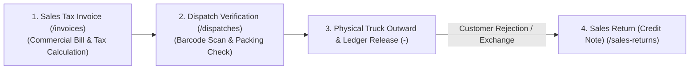
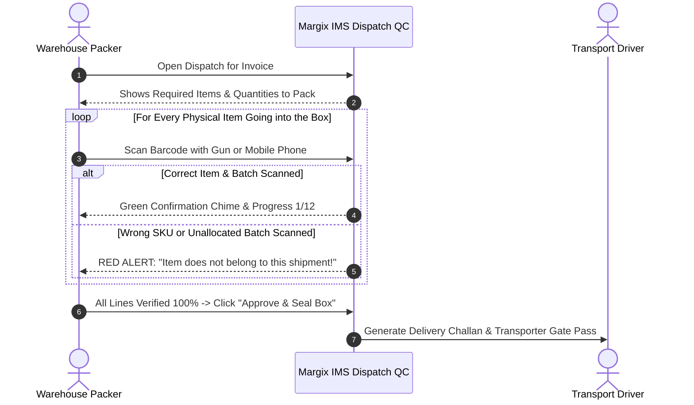

# Margix IMS — Enterprise Inventory & Warehouse Management System
## Chapter 4: Outbound Logistics, Invoicing & Dispatch QC

---

### 1. Outbound Order Fulfillment Workflow

Outbound logistics governs sales invoicing, statutory GST tax computation, warehouse pick-pack verification, dispatch release, and sales returns.

---

### 2. Sales Invoicing & Billing (`/invoices`)

The Sales Invoice is the legal tax document issued to buyers. Margix IMS supports both **B2B Registered Invoices** (with input tax credit) and **B2C Consumer Invoices**.

#### Step-by-Step Invoice Creation:

1. **Customer Selection**: Choose customer from master. The system auto-populates billing/shipping addresses, GSTIN, and the 2-digit GST state code.
2. **Godown Selection**: Specifies which warehouse location the inventory will be billed and picked from.
3. **Item Entry via Barcode Scanning**:
   - Aim scanner at product barcode.
   - If the item is in stock, it is added to the lines editor. Scanning the same barcode repeatedly increments the line quantity.
   - For batch-tracked items, select the specific available batch number (sorted by FIFO or FEFO - First Expired First Out).
4. **Automated Indian GST Dual-Tax Computation**:
   - The system compares the **Customer State Code** against the **Tenant Business State Code**:
     - **Same State (Intra-State)**: Automatically splits tax into equal **CGST** and **SGST** (e.g. 18% GST $\rightarrow$ 9% CGST + 9% SGST).
     - **Different State (Inter-State)**: Applies full **IGST** (e.g. 18% IGST).
5. **Invoice Finalization & Ledger Release**:
   - Finalizing the invoice generates immutable `OUTWARD` ledger entries with a negative sign (`-`), reducing physical stock balances atomically.

---

### 3. Warehouse Dispatch Verification & Packing QC (`/dispatches`)

In high-volume warehouses, shipping errors (such as placing a 500g bottle instead of a 1kg bottle into a box, or packing an expired batch) create costly returns and customer penalties.

Margix IMS features a dedicated **Dispatch Verification & QC Station** (`/dispatches`):

#### Dispatch Safety Guarantees:
- **Zero Dispatch Drift**: A shipment cannot be closed until every single unit on the order has been physically scanned and matched against the authorized batch.
- **Transporter Gate Pass**: Includes vehicle number, transporter ID, driver contact, and E-Way bill reference numbers.

---

### 4. Sales Returns (Credit Notes) (`/sales-returns`)

When a customer returns goods due to order cancellation, damage in transit, or store returns:
1. **Source Linking**: Return can be linked directly to the original Sales Invoice, preventing fraudulent return of products never sold to that customer.
2. **Physical Inspection & Restocking**:
   - **Restockable Units**: Inspected sound units returned to active stock in a designated godown.
   - **Damaged Units**: Written off directly to a scrap location with reason code.
3. **Ledger Impact**: Restocked units write an `INWARD_RETURN` entry with a positive sign (`+`), restoring inventory balances.
4. **GST Credit Note**: Automatically calculates the exact tax reversal amounts for GST GSTR-1 and GSTR-3B monthly statutory filing.

---

### 5. Document Printing & Export Formats

Margix IMS generates compliant, high-resolution printable documents formatted for both A4 Laser Printers and Thermal Label Printers:

- **GST Tax Invoice (`/(print)/invoices/[id]`)**:
  - Original for Recipient, Duplicate for Transporter, Triplicate for Supplier.
  - Complete HSN/SAC summary table showing Taxable Value, CGST, SGST, IGST, and Total Tax.
  - Indian Currency Words formatting (e.g. *"Rupees One Lakh Twenty-Four Thousand Five Hundred Only"*).
  - High-density QR code encoding invoice metadata for fast mobile scanning.
- **Delivery Challan (`/(print)/dispatches/[id]`)**: For inter-branch stock transfers and job work movements without commercial pricing.
- **Product Barcode Labels (`/(print)/masters/skus`)**: Formatted for 2-inch and 4-inch thermal label rolls (Zebra, TSC, Citizen) displaying Product Code, Name, MRP, and Barcode.

