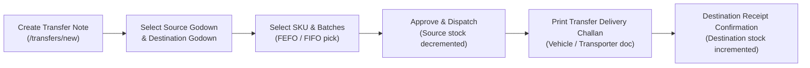

# Chapter 5: Warehouse & Inventory Stock Operations

## 5.1 Overview & Core Architecture

The inventory core of Margix IMS is built on a **double-entry, immutable inventory ledger model**. In Margix IMS, stock balances are never updated via raw SQL `UPDATE stock SET quantity = quantity + 10` statements. Every physical receipt, dispatch, transfer, adjustment, and opening balance records an immutable transaction event in the `inventory_ledger` table with strict cryptographic referential integrity.

Current on-hand stock balances in `stock_balance` represent a materialized view maintained in real-time within the same atomic database transaction as the ledger entry. This architecture ensures that stock discrepancies can always be audited, traced, and mathematically proven back to the initiating commercial document.

---

## 5.2 Real-Time Stock Balance View (`/stock`)

The primary inventory monitoring console is accessible at `/stock`. It provides an operational overview of all SKUs across all warehouse godowns.

### Key Metrics Displayed:
1. **On-Hand Quantity**: Total physical units located in the warehouse.
2. **Allocated Quantity**: Units reserved for approved sales orders or active dispatch notes pending final physical gate-exit.
3. **Available Quantity**: Calculated dynamically as:
   $$\text{Available} = \text{On-Hand} - \text{Allocated}$$
4. **Reorder Status**: Evaluated against configured thresholds:
   - **Adequate**: Current available stock > Reorder point.
   - **Low Stock Warning**: Current stock $\le$ Reorder point (triggers automated badge and optional alert).
   - **Out of Stock**: Available stock = 0.
5. **Godown Breakdown**: Toggleable multi-location view showing stock distribution across Main Godown, Bulk Storage, Cold Room, etc.

---

## 5.3 SKU Stock Detail & Batch Breakdown (`/stock/[skuId]`)

Clicking any SKU in the stock register opens the SKU Stock Detail console at `/stock/[skuId]`. This view is organized into three tabs:

### 1. Batch & Lot Distribution
- **Batch Number**: Unique identifier assigned during supplier GRN or manufacturing.
- **Manufacturing Date (Mfg)**: Date of production.
- **Expiry Date (Exp)**: Expiry date with color-coded alerts:
  - **Green**: > 90 days remaining.
  - **Amber**: 30 to 90 days remaining (approaching shelf life).
  - **Red / Strikethrough**: Expired stock (blocked from outbound sales dispatch).
- **Current Quantity per Batch**: Physical units remaining in each lot.
- **FEFO (First-Expired, First-Out) Priority**: System automatically sorts and recommends batches with earliest expiry for picking.

### 2. Location Distribution
Shows the exact godown location of every batch. For multi-godown facilities, operators can immediately identify which rack or godown holds available stock.

### 3. SKU Transaction History
A dedicated timeline filtering the immutable ledger specifically for this SKU, displaying every GRN, invoice dispatch, inter-godown transfer, or adjustment note that affected its balance.

---

## 5.4 The Immutable Inventory Ledger (`/ledger`)

The global stock ledger is accessible at `/ledger`. It acts as the audit trail for regulatory compliance and internal loss-prevention audits.

### Ledger Record Schema:
| Column | Description |
| :--- | :--- |
| **Timestamp** | ISO-8601 UTC timestamp of the transaction. |
| **SKU Code & Name** | Item identifier. |
| **Godown** | Specific warehouse location where the stock entered or exited. |
| **Movement Type** | Direction and operational purpose: `IN`, `OUT`, `TRANSFER_IN`, `TRANSFER_OUT`, `ADJUSTMENT_IN`, `ADJUSTMENT_OUT`, `OPENING`. |
| **Quantity** | Base UOM quantity (positive for inbound, negative for outbound). |
| **Balance After** | Running physical balance in the godown immediately following this event. |
| **Batch / Serial** | Associated batch number or unique serial number. |
| **Document Ref** | Hyperlink to the source document (e.g. `GRN-00042`, `INV/2026/0124`, `TRN-00015`, `ADJ-00008`). |
| **Operator** | Name and ID of the authenticated user who committed the action. |

> [!NOTE]
> Ledger entries can never be modified or deleted, even by system administrators. If an operational error was committed (e.g., entering 500 units instead of 50 in a GRN), the system requires issuing a formal **Correction Adjustment Note** or **Purchase Return** to record an offset entry.

---

## 5.5 Inter-Godown Stock Transfers (`/transfers`)

When goods need to move between physical warehouses, branch godowns, or quality quarantine zones, the Inter-Godown Transfer workflow ensures both ends of the transfer are documented.

### Transfer Workflow:

### Operational Steps:
1. Navigate to **Transfers** $\to$ **New Transfer** (`/transfers/new`).
2. Select **Source Godown** (where goods currently sit) and **Destination Godown** (where goods are heading).
3. Add item lines by typing SKU code, name, or scanning the product barcode.
4. Select the specific **Batch Number** to move.
5. Enter the quantity. The system enforces that transfer quantity cannot exceed available stock in the source godown.
6. Click **Submit Transfer**.
7. The system generates an official **Transfer Note (TRN)** with a printable Goods Challan containing transporter name, vehicle registration number, and itemized batch list.

---

## 5.6 Physical Stock Adjustments & Write-Offs (`/adjustments`)

Physical cycle counts regularly reveal minor discrepancies between physical shelf counts and system figures due to shrinkage, accidental damage, customer samples, or expired goods. The Adjustments module at `/adjustments` reconciles these variances.

### Reason Codes Supported:
- `DAMAGE`: Damaged packaging or broken products removed from stock.
- `THEFT_OR_SHRINKAGE`: Unaccounted loss identified during physical audit.
- `EXPIRY`: Out-of-shelf-life goods written off to scrap.
- `FOUND_STOCK`: Surplus units discovered during physical shelf audit.
- `CORRECTION`: Data-entry corrections with mandatory audit explanation.
- `SAMPLE`: Marketing or client demonstration samples disbursed.

### Adjustment Creation:
1. Navigate to **Adjustments** $\to$ **New Adjustment** (`/adjustments/new`).
2. Select the target **Godown**.
3. Add SKUs and select whether the adjustment is:
   - **Increase (Positive)**: Adds stock to the godown.
   - **Decrease (Negative)**: Removes stock from the godown.
4. If decreasing batch-tracked inventory, select the specific batch and enter the quantity.
5. Select the **Reason Code** and enter an explanatory **Remarks** note (mandatory for audit compliance).
6. Click **Post Adjustment**. The stock balance updates instantly and an `ADJUSTMENT_IN` or `ADJUSTMENT_OUT` ledger entry is posted.

---

## 5.7 Opening Stock Initialization (`/opening-stock`)

When onboarding a new warehouse or migrating from legacy systems (such as legacy Tally, Busy, or Excel), initial stock balances must be imported without requiring fake purchase orders.

### Features of Opening Stock:
- Access at `/opening-stock` $\to$ **New Opening Balance** (`/opening-stock/new`).
- Supports single entry via barcode scanner or bulk multi-item entry.
- Captures initial batch numbers, manufacturing dates, expiry dates, and unit purchase cost valuation.
- Assigns transaction type `OPENING` in the immutable ledger, providing a clean historical baseline.

---

## 5.8 Automated Low Stock Alerts & Reorder Rules (`/alerts`)

Margix IMS features an automated notification daemon that continuously monitors stock balances against defined reorder rules.

### Configuring Reorder Rules:
1. Under SKU Master (`/masters/skus`) or Reorder Rules (`/alerts`), set:
   - **Minimum Safety Stock (Min)**: Minimum buffer before an alert triggers.
   - **Reorder Level (ROP)**: Stock quantity that indicates a purchase order must be raised.
   - **Optimal Reorder Quantity (EOQ)**: Standard batch quantity to order.
2. When available stock drops below the threshold:
   - A warning notification is sent to warehouse managers via Email and WhatsApp (Meta Cloud API).
   - A task item appears in the **Dashboard** under *Critical Stock Alerts*.
   - A direct link is provided to create a Purchase Order (`/purchase-orders/new?skuId=...`) populated with the recommended reorder quantity.

