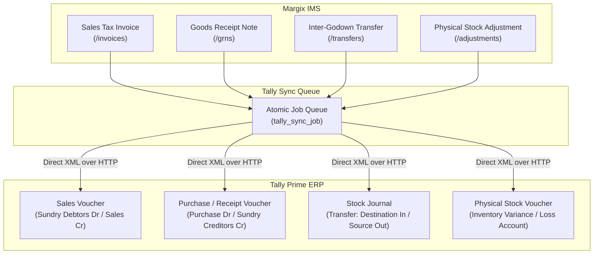

# Chapter 8: Tally Prime ERP Bidirectional Integration

## 8.1 Integration Architecture & Philosophy

Tally Prime is the dominant statutory accounting and ERP software across Indian commercial enterprises. Margix IMS provides an **asynchronous, non-blocking, bidirectional integration bridge** to Tally Prime.

### Architectural Principles:
1. **Zero Database Blocking**: Calls to Tally occur asynchronously via a persistent job queue (`tally_sync_job`). A network interruption, computer freeze, or configuration issue in Tally Prime will **never** roll back, slow down, or block warehouse operations (such as generating an invoice or receiving a GRN).
2. **Double-Lock Leased Queueing**: Jobs are claimed using atomic PostgreSQL locking (`UPDATE ... FOR UPDATE SKIP LOCKED` equivalent with `locked_until` leases), preventing duplicate voucher postings across clustered server instances.
3. **Exponential Backoff & Self-Healing**: Failed sync attempts back off exponentially across up to 8 automatic attempts (`MAX_AUTO_ATTEMPTS = 8`) before requiring manual intervention.
4. **Idempotent Voucher Addressing**: Every voucher carries a unique deterministic GUID derived from the source document number. If Tally Prime receives the same voucher twice due to a network timeout retry, it updates the existing voucher rather than duplicating accounting balances.

---

## 8.2 Operational Modes (`TALLY_MODE`)

The integration mode is configured in server environment variables:

| Mode | Environment Value | Purpose |
| :--- | :--- | :--- |
| **Direct XML Bridge** | `TALLY_MODE=xml` | **Production Mode**. Streams live XML requests over HTTP directly to Tally Prime's gateway (default: `http://localhost:9000` or corporate LAN/VPN IP). |
| **Mock Gateway** | `TALLY_MODE=mock` | **Testing / Demo Mode**. Automatically accepts all vouchers with synthetic `MOCK-<VOUCHER_NO>` acknowledgments without contacting Tally. |
| **Simulated Outage** | `TALLY_MODE=fail` | **Resilience Testing**. Simulates network failure to verify that the warehouse continues operating without interruption and queues jobs properly. |
| **Disabled** | `TALLY_MODE=disabled` | Integration inactive. No jobs are queued. |

---

## 8.3 Master Data Synchronization (`/tally`)

Before transactional vouchers can post cleanly, master entities between Margix IMS and Tally Prime must be synchronized or mapped.

### Synchronized Entities:
1. **Godowns (Locations)**:
   - Margix Godowns map 1:1 to Tally Godowns (e.g. `Main Godown`, `Warehouse B`).
   - If a Godown does not exist in Tally, Tally can be configured to auto-create it or reject with a descriptive mapping error.
2. **Stock Items & UOMs**:
   - Margix SKU Code $\to$ Tally Stock Item Name.
   - Base UOM (e.g. `PCS`, `BOX`, `KGS`) must match Tally's Unit of Measurement definitions.
   - HSN Code and GST tax rate are embedded in the stock item definition.
3. **Ledgers (Customers & Suppliers)**:
   - Customer Master $\to$ Tally *Sundry Debtors*.
   - Supplier Master $\to$ Tally *Sundry Creditors*.
   - GSTIN, State Code, and address details map directly.

---

## 8.4 Voucher Posting Workflows

Margix IMS maps warehouse transactions to Tally Prime accounting vouchers:

### 1. Sales Invoices $\to$ Tally Sales Vouchers:
- Debits Customer Ledger (*Sundry Debtors*).
- Credits Sales Account with net taxable value.
- Credits Output CGST and Output SGST (or Output IGST for inter-state sales).
- Automatically deducts stock from the specified Tally Godown for each line item.

### 2. Purchase GRNs $\to$ Tally Purchase / Receipt Vouchers:
- Credits Supplier Ledger (*Sundry Creditors*).
- Debits Purchase Account / Inventory Asset.
- Debits Input Tax Credit (ITC) CGST/SGST/IGST accounts.
- Increases inventory balances in Tally Godown with batch numbers and expiry dates.

### 3. Inter-Godown Transfers $\to$ Tally Stock Journals:
- Creates a dual-table **Stock Journal** voucher.
- Source Godown entries recorded under *Consumption / Source*.
- Destination Godown entries recorded under *Production / Destination*.

### 4. Stock Adjustments $\to$ Tally Physical Stock Vouchers:
- Decrements stock against *Stock Loss due to Damage/Shrinkage* or increments stock against *Unaccounted Stock Found*.

---

## 8.5 Sync Queue Console & Error Diagnostics (`/tally`)

The Tally Sync dashboard at `/tally` provides operators and accountants with complete visibility into integration health.

### Features & Controls:
1. **Connection Status Pill**: Real-time ping indicator displaying Tally Prime availability at `TALLY_URL`.
2. **Job Status Breakdown**:
   - **Synced (Green)**: Successfully committed to Tally with Tally Voucher GUID.
   - **In Progress (Blue)**: Currently being transmitted.
   - **Pending (Gray)**: Awaiting transmission.
   - **Failed (Red)**: Rejection returned by Tally Prime (e.g. *"Ledger 'Acme Corp' does not exist in Tally"* or *"Item 'SKU-001' is out of stock in Godown"*).
3. **One-Click Manual Retry (`retryTallyJob`)**:
   - Resolving the root cause in Tally (e.g. creating the missing ledger) allows clicking **Retry Job** in Margix IMS.
   - Resets attempts counter to zero and schedules immediate queue execution.
4. **Detailed XML Payload Inspector**:
   - Operators can expand any failed job to view the exact raw XML request sent to Tally and the exact response string returned by Tally Prime for rapid diagnosis.
