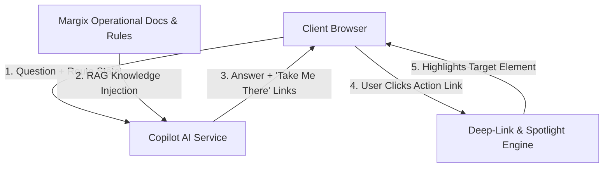

# Product Requirements Document (PRD)
# AI System Walkthrough & Interactive Copilot (Product-to-Sale Journey)

**Document Version:** 1.0.0  
**Target Platform:** Margix Inventory & Sales Management System (IMS)  
**Status:** Ready for Engineering & Product Review  
**Document Type:** Product Requirements Document (PRD)  

---

## 1. Executive Summary & Problem Statement

### 1.1 Executive Summary
Operating an enterprise Inventory Management System (IMS) involves non-trivial workflows: establishing SKU master catalogs, navigating multi-level units of measurement, raising Purchase Orders (PO), receiving Goods Receipt Notes (GRN) with strict batch and expiry tracking, maintaining an immutable ledger, generating sales invoices, and performing batch picking using FEFO (First-Expired, First-Out) dispatch.

New operators, store managers, and accounts executives frequently experience onboarding friction, leading to human errors, improper data entry, delayed order dispatches, and heavy L1 support overhead.

The **Margix AI Walkthrough & Copilot System** solves this by providing:
1. **An End-to-End Guided Walkthrough:** Guiding users step-by-step through the core lifecycle: **Adding a Product ➔ Purchasing & Inwarding ➔ Inventory Audit ➔ Invoicing & Billing ➔ FEFO Dispatch & Completion**.
2. **Omnipresent Contextual Q&A:** An AI Copilot accessible across all screens that answers operational questions, explains system validations, and demystifies accounting/ledger rules.
3. **Interactive "Take Me There" Deep-Linking:** Clicking any AI action, milestone recommendation, or resolution link immediately navigates the browser to the exact page, auto-scrolls, and spotlights the specific field or button with visual beacons.

### 1.2 Problem Statement & User Pain Points
* **Disjointed Learning Curve:** Users don't know the prerequisite order (e.g., trying to dispatch an invoice before receiving goods into a godown batch).
* **Ledger Immutability Confusion:** Unlike spreadsheets, stock cannot simply be typed over; users need guidance on how documents create signed ledger entries (`INWARD`, `OUTWARD`, `TRANSFER`, `ADJUSTMENT`).
* **Context Switching:** Users have to leave their active task to read manuals or call support when encountering errors like `INSUFFICIENT_STOCK` or `OVER_RECEIPT`.
* **Action Paralysis:** Standard onboarding tooltips merely display passive text rather than directly navigating to and highlighting the exact inputs.

---

## 2. Goals & Success Metrics

| Goal | Success Metric (KPI) | Target |
| :--- | :--- | :--- |
| **Accelerate Onboarding** | Time-to-First-Sale (TTFS) | Reduced from 4 days to **< 20 minutes** |
| **Increase Self-Sufficiency** | Walkthrough Full Completion Rate | **> 85%** of new store managers |
| **Support Deflection** | Inward & Dispatch how-to support tickets | **70% reduction** in first 60 days |
| **Reduce Operational Errors** | Rejected dispatch & over-receipt attempts | **< 2%** of total transactions |
| **Copilot Engagement** | Helpful rating on Q&A responses | **> 90% positive** user satisfaction |

---

## 3. User Personas

1. **Store Manager (Primary Persona):**  
   * *Responsibilities:* Creating purchase orders, tracking vendor supplies, monitoring warehouse inventory levels, and managing stock health.  
   * *Needs:* Clear step-by-step guidance on creating master items and turning POs into accepted stock batches.
2. **Warehouse Operator:**  
   * *Responsibilities:* Material receipts (GRN), quality checks (accepted vs rejected qty), pallet batching, and physical picking for dispatches.  
   * *Needs:* Highlighting where to scan/enter batches and how to trigger automated FEFO picking.
3. **Billing / Accounts Executive:**  
   * *Responsibilities:* Creating customer invoices, checking tax computations, monitoring dispatches against invoices, and verifying Tally sync status.  
   * *Needs:* Instant Q&A answers on pricing, alternate unit conversions, and invoice status transitions.
4. **Enterprise Administrator:**  
   * *Responsibilities:* Master configurations, user permissions, opening stock, and audit compliance.  
   * *Needs:* Ability to assign walkthrough checklists and inspect team onboarding completion.

---

## 4. End-to-End Walkthrough Journey: From Adding Product to Complete Selling

The core AI walkthrough is structured as an interactive 6-milestone progressive journey. Each milestone features automated navigation, target element spotlighting, interactive instructions, and integrated Q&A.


---

### 4.1 Milestone 1: Master Setup — Adding the Product (SKU Master)

* **Route:** `/masters/skus/new`
* **Trigger:** User launches *"Product-to-Sale Walkthrough"* from the dashboard or AI drawer.
* **Navigation Behavior ("Take Me There"):**  
  Clicking *"Start Milestone 1: Add Product"* immediately routes to `/masters/skus/new`.

#### Walkthrough Sequence & Visual Spotlights
1. **Spotlight 1 — SKU Code & Item Name:**  
   * *Element Targeted:* `#sku-code-input`, `#sku-name-input`  
   * *AI Guidance Card:* *"Every item starts with an immutable SKU code and descriptive name (e.g., Code: `SKU-BASMATI-01`, Name: `Royal Basmati Rice 10kg`)."*
2. **Spotlight 2 — Base Unit & Alternate Conversion:**  
   * *Element Targeted:* `#base-unit-select`, `#add-unit-button`  
   * *AI Guidance Card:* *"Select your base unit (e.g., `PCS` or `KG`). If you buy or sell in cartons or bags, add an Alternate Unit with a conversion factor (e.g., 1 BAG = 25 KG)."*
3. **Spotlight 3 — Tax Slab & HSN:**  
   * *Element Targeted:* `#hsn-input`, `#gst-rate-select`  
   * *AI Guidance Card:* *"Enter your HSN code and GST rate (e.g., 5%, 12%, 18%). Margix uses this to automatically calculate CGST/SGST/IGST on invoices."*
4. **Spotlight 4 — Save & Transition:**  
   * *Element Targeted:* `#create-sku-submit-btn`  
   * *Action:* User saves the SKU. The AI system intercepts successful creation and displays an interactive modal:  
     `[🎉 SKU Created Successfully! | Next: Inward Physical Stock via Purchase Order ->]`

#### Contextual Q&A Prompts for Milestone 1
* **Q: "Can I edit the SKU code after saving?"**  
  * *AI Answer:* "SKU codes become permanent audit anchors once transactions exist. You can update names, categories, and tax slabs anytime, but SKU codes cannot be altered."
* **Q: "What is the difference between Base Unit and Sales Unit?"**  
  * *AI Answer:* "Base Unit is the atomic unit in which stock is tracked on the ledger. Sales Unit is how customers buy. Margix auto-converts sales units back to base units on every dispatch."

---

### 4.2 Milestone 2: Procurement & Inward Stocking (PO & GRN)

* **Routes:** `/purchase-orders/new` ➔ `/grns/new`
* **Objective:** Order stock from a vendor and physically receive it into a warehouse godown with batch numbers and expiry tracking.

#### Walkthrough Sequence & Visual Spotlights
1. **Part A: Create Purchase Order (`/purchase-orders/new`)**  
   * *Take Me There Action:* AI loads the PO form and spotlights the **Supplier** field and **Add Line Item** table.  
   * *AI Guidance:* *"Stock enters through structured documents. Select a supplier, add your newly created SKU, and specify order quantity (e.g., 100 PCS @ ₹400)."*  
   * *Submission:* User clicks *"Submit Purchase Order (`OPEN`)"*.
2. **Part B: Receive Goods via GRN (`/grns/new?poId={PO_ID}`)**  
   * *One-Click Hop:* AI banner appears on the PO: *"PO #PO-101 is OPEN. Let's receive the goods at your warehouse!"* ➔ User clicks **`[Receive Goods via GRN]`**.  
   * *Spotlight 1 (Destination Godown):* AI spotlights the godown selector: *"Select which warehouse (Godown) will store these items."*  
   * *Spotlight 2 (Batch Number & Expiry Date):* Highlights batch inputs: *"Crucial step! Enter the manufacturer batch number (`BATCH-2026-A`) and expiration date."*  
   * *Spotlight 3 (Accepted vs Rejected Quantity):* Points to inspection fields: *"Only accepted quantity enters your stock ledger. Damaged goods can be rejected here with a reason."*  
   * *Submission:* User posts GRN. AI notifies: `[Stock Inward Successful: +100 PCS posted to Ledger]`.

#### Contextual Q&A Prompts for Milestone 2
* **Q: "Can I receive goods without a Purchase Order?"**  
  * *AI Answer:* "In standard operational mode, all supplier receipts require a PO for financial tracking. However, for initial inventory migrations, you can use the Opening Stock module (`/opening-stock`)."
* **Q: "What happens if the supplier delivers more than ordered?"**  
  * *AI Answer:* "Margix enforces strict over-receipt protection (`OVER_RECEIPT`). You must either amend the PO or reject the surplus quantity at the dock."

---

### 4.3 Milestone 3: Inventory Verification & Reorder Rules

* **Routes:** `/stock` ➔ `/ledger` ➔ `/alerts`
* **Objective:** Teach users how to verify on-hand vs available stock, review immutable ledger entries, and configure automatic low-stock reorder alerts.

#### Walkthrough Sequence & Visual Spotlights
1. **Spotlight 1 — Live Stock View (`/stock`):**  
   * Clicking **`[View Live Stock]`** navigates to `/stock`, auto-filtered to the newly added SKU.  
   * Highlights: *Current On-Hand*, *Batch Breakdown*, and *Godown Location*.
2. **Spotlight 2 — Double-Entry Stock Ledger (`/ledger`):**  
   * Clicking **`[Inspect Ledger Entry]`** navigates to `/ledger`.  
   * Highlights the newly created line: `Movement: INWARD | Qty: +100 | Doc: GRN-2026-001`.  
   * AI Callout: *"Notice the positive sign (+) and post-transaction balance. Every stock change in Margix is an immutable ledger entry."*
3. **Spotlight 3 — Set Low-Stock Alert:**  
   * AI triggers prompt: *"Prevent stockouts! Let's set a reorder threshold."*  
   * Button **`[Set Reorder Level]`** opens modal, pre-fills reorder quantity: `25 PCS`, and saves.

#### Contextual Q&A Prompts for Milestone 3
* **Q: "Why can't I edit the stock balance directly on this screen?"**  
  * *AI Answer:* "Margix uses an immutable financial ledger design. Direct number edits cause inventory discrepancies. Stock can only move via verified documents: GRNs, Dispatches, Transfers, or Approved Adjustments."
* **Q: "When does the low-stock alert trigger?"**  
  * *AI Answer:* "Every dispatch transaction checks remaining balance in real time. If total available stock falls below your reorder level (25 PCS), a `LOW_STOCK` alert appears on your dashboard."

---

### 4.4 Milestone 4: Sales Billing & Invoicing

* **Route:** `/invoices/new`
* **Objective:** Generate a customer sales order/invoice, choose billing units, calculate taxes, and understand invoice fulfillment statuses.

#### Walkthrough Sequence & Visual Spotlights
1. **Take Me There Navigation:**  
   Clicking **`[Milestone 4: Create Invoice]`** directly opens `/invoices/new`.
2. **Spotlight 1 — Customer Selection:**  
   * *Target:* `#customer-select-field`  
   * *AI Guidance:* *"Choose a registered customer or create a new buyer on the fly."*
3. **Spotlight 2 — Line Item & Live Stock Availability:**  
   * *Target:* `#invoice-line-items`  
   * *AI Guidance:* *"Select your SKU. Notice the real-time badge showing `100 PCS Available in Main Godown`. Enter selling quantity (e.g., 30 PCS) and rate."*
4. **Spotlight 3 — Automated Tax Calculation:**  
   * *Target:* `#invoice-tax-summary`  
   * *AI Guidance:* *"GST (CGST/SGST or IGST) is automatically computed based on customer state and SKU HSN tax slab."*
5. **Submission & Status Explanation:**  
   * User posts invoice. System creates `INV-2026-001` with status `OPEN`.  
   * AI Popover: *"Great job! The invoice is created. Remember: An invoice records the financial sale, but inventory has NOT been deducted yet. Next step is physical dispatch!"*

#### Contextual Q&A Prompts for Milestone 4
* **Q: "Did creating this invoice reduce my stock?"**  
  * *AI Answer:* "No. Invoicing allocates demand, but physical inventory remains on hand until a Dispatch document is posted. This ensures that only dispatched items leave your ledger."
* **Q: "Can I cancel an invoice if the customer changes their mind?"**  
  * *AI Answer:* "Yes! As long as nothing has been dispatched against it, you can cancel an `OPEN` invoice with a recorded reason."

---

### 4.5 Milestone 5: Batch Picking & FEFO Dispatch (Fulfillment)

* **Route:** `/dispatches/new?invoiceId={INVOICE_ID}`
* **Objective:** Fulfill the invoice by picking batches using FEFO (First-Expired, First-Out), printing the Delivery Challan, and completing the outward stock movement.

#### Walkthrough Sequence & Visual Spotlights
1. **Take Me There Navigation:**  
   Clicking **`[Milestone 5: Dispatch Order]`** navigates to `/dispatches/new` with the customer invoice pre-linked.
2. **Spotlight 1 — Source Godown Selection:**  
   * *Target:* `#godown-source-select`  
   * *AI Guidance:* *"Select the godown where the goods are physically staged."*
3. **Spotlight 2 — The "Pick Batches (FEFO)" Magic Button:**  
   * *Target:* `#fefo-auto-pick-btn`  
   * *AI Guidance:* *"Click this button! Margix scans available inventory and automatically allocates units from the earliest-expiring batch (`BATCH-2026-A`), preventing expired stock from shipping."*
4. **Spotlight 3 — Post Dispatch & Generate Challan:**  
   * *Target:* `#post-dispatch-submit-btn`  
   * *Action:* User posts dispatch. The system generates Delivery Challan `DC-2026-001` and marks invoice as `COMPLETE`.
5. **Ledger Deduction Live Card:**  
   * AI displays instantaneous feedback:  
     `[Ledger Updated: -30 PCS OUTWARD | Remaining Stock in Godown: 70 PCS | Invoice Status: COMPLETE]`

#### Contextual Q&A Prompts for Milestone 5
* **Q: "What happens if I try to dispatch more than what is in stock?"**  
  * *AI Answer:* "The transaction is immediately blocked with an `INSUFFICIENT_STOCK` error. Margix mathematically prohibits negative stock balances."
* **Q: "Can I do partial dispatches?"**  
  * *AI Answer:* "Yes! You can dispatch 15 PCS today and 15 PCS next week. The invoice will display `PARTIALLY_DISPATCHED` until all items are fulfilled."

---

### 4.6 Milestone 6: Post-Sale Reconciliation & Onboarding Completion

* **Routes:** `/invoices/{ID}` ➔ `/tally` ➔ `/reports/movement`
* **Objective:** Validate end-to-end auditability, verify Tally Prime synchronization status, review stock movement reports, and award completion.

#### Walkthrough Sequence & Visual Spotlights
1. **Spotlight 1 — Completed Invoice Record:**  
   AI brings user to `/invoices/INV-2026-001`, highlighting the `COMPLETE` status badge and linked Delivery Challan.
2. **Spotlight 2 — Tally Prime Sync Queue (`/tally`):**  
   AI navigates to `/tally` and spotlights the sync queue: *"Both your GRN and Dispatch vouchers have been queued for automated Tally Prime accounting integration."*
3. **Walkthrough Grand Finale & Certification:**  
   * Full-screen celebratory modal with interactive completion report:
     * *Product Created:* 1 SKU (`Royal Basmati Rice 10kg`)
     * *Stock Inwarded:* 100 PCS via GRN
     * *Order Billed:* 30 PCS @ ₹450
     * *Dispatched via FEFO:* Delivery Challan Posted
     * *Final Stock Balance:* 70 PCS Audited
   * Action buttons: `[Download Cheatsheet PDF]`, `[Invite Team Member]`, `[Finish Walkthrough]`.

---

## 5. Omnipresent Q&A Assistant (Copilot) Architecture

The Q&A system is active on every page, offering continuous conversational assistance.

### 5.1 Context Awareness Engine
Every user query sent to the AI Copilot is automatically enriched with the client's current runtime context:
* **Current Route:** (e.g., `/dispatches/new`)
* **Active Form State:** Selected godown, line item count, active SKU IDs, entered quantities.
* **User Role & Permissions:** (Admin, Store Manager, Warehouse Operator, Accounts).
* **DOM Error State:** Active form validation warnings, API error toasts (e.g. `INSUFFICIENT_STOCK`).
* **Screen Anchor:** The business record the user is looking at, so relative commands ("delete it", "show its batches", "iska detail batao") resolve without a clarifying question.
* **Document Knowledge Base:** Official Margix workflow rules, double-entry ledger specifications, tax rules, and Tally sync specifications.


#### 5.1.1 Screen Anchoring

The anchor identifies one record — `{ kind, id, label, source }` — and is resolved from two sources, selection first:

| Source | How it is captured | Covers |
| :--- | :--- | :--- |
| `selection` | A row or card carrying `data-copilot-entity` / `-entity-id` / `-entity-label`, picked when it is marked selected (`data-copilot-selected`, `aria-selected`, `aria-current`) or contains keyboard focus. | List screens that opt in (currently the shared supplier/customer table). |
| `route` | The record id in the URL of any detail screen (`/purchase-orders/<id>`). Derived in the browser, and again on the server so non-browser callers and older clients still anchor. | Every detail screen, with no page-level change. |

List screens, create forms and action segments (`/new`, `/edit`, `/labels`, `/print`) deliberately produce **no** anchor — guessing there is worse than asking which record is meant.

The anchor reaches the model two ways:
* The LLM path injects a `SCREEN CONTEXT ANCHOR` instruction plus the anchor JSON into the system prompt, and requires the record to be confirmed by id with its lookup tool before any action is proposed.
* The autonomous agent path (LLM offline, or a confirmation reply) maps the anchor to that record's detail tool — `get_supplier_detail`, `get_invoice_detail`, and so on — whenever the message is a pronoun reference it could not otherwise resolve, and answers with the record plus its next logical business steps.

Definitions live in `src/lib/copilot/screen-anchor.ts`; browser capture in `src/lib/copilot/runtime.ts`.

To anchor a new list screen, put the three data attributes on the row element — no other wiring is needed.



### 5.1.2 Two-Tier Routing, Autonomy and Prompt Budget

Every question is routed before any provider call is made. `src/server/modules/copilot/routing.ts` is the single source of truth for that decision, and the same detection drives both the tool list and the system prompt so they cannot drift apart.

**Tier 1 — deterministic (no provider call).** A plain lookup is rendered straight from the database by the autonomous planner: zero latency from the model, zero tokens, and no chance of the model editorialising over data it did not change. `shouldUseFastPath` is deliberately conservative — it requires a whitelisted read-only intent, and refuses anything asking for judgement (`why`, `analyse`, `compare`, `recommend`, `kyun`, `kaise`), anything over 16 words, and any mid-conversation turn.

**Tier 2 — the model, run as an autonomous agent.** The loop in `llm.ts` lets the model call tools, read the results and decide what to do next, up to `MAX_TOOL_ROUNDS` (6). Tool calls requested in the same round run **concurrently**, so a three-lookup round costs one round trip rather than three.

**Cost and latency controls.** Each round re-sends the whole prompt and every tool schema, so the budget is enforced on three axes:

| Control | Where | Effect |
| :--- | :--- | :--- |
| Domain-scoped tool schemas | `copilotToolsForRole` | Only the domains a question touches are offered, instead of all 76 tools. |
| Domain-scoped playbooks | `DOMAIN_PLAYBOOKS` in `knowledge.ts` | The market, sales and APMC playbooks ship only when relevant; the static core is ~45% smaller than the old monolithic prompt. |
| Stable cacheable prefix | `CORE_INSTRUCTIONS` first, runtime JSON last | The prefix is byte-identical across requests so providers can cache it; only the tail varies. |
| Per-result cap | `MAX_TOOL_RESULT_CHARS` (6k) | One wide list cannot dominate the context of every later round. |
| Whole-turn ceiling | `MAX_TURN_PROMPT_CHARS` (120k) | Round count alone does not bound cost; when the budget is spent the tools are withdrawn and the model answers from what it has. |
| History clamp | `clampHistory`, re-applied every round | The working set stays bounded as agent rounds accumulate. |

### 5.1.3 Live Execution Visibility

An agent that works for ten seconds in silence reads as a hung window. Both answer paths therefore stream what they are doing while they do it, over the same SSE protocol:

* `{"type":"plan", thinking, steps[]}` — the steps now known, each with a status.
* `{"type":"step", stepIndex, status, outputSummary}` — one step changed.
* `{"delta":"…"}` — answer text, once the agent is ready to write.

The autonomous planner knows its whole plan upfront and sends it in one `plan` event. The model-driven path discovers work a round at a time, so it **appends** to the plan on every tool round: as soon as the model asks for tools, each call is named from its arguments (`describeCopilotToolCall` — "Purchase Order Detail · identifier: PO-2026-0001") and reported as `running`; because the round's calls run concurrently, each reports its own `completed`/`failed` and row count the moment it settles rather than waiting for its slowest sibling.

All three event shapes are defined once in `src/lib/copilot/stream-events.ts` and used by every emitter and by the browser decoder. A compile-time check (`COPILOT_STREAM_CONTRACT_VERIFIED`) fails the build if a server event ever gains a field the browser frame cannot read — previously the two sides were untyped object literals, and a guardrail refusal emitted as `{type:"token",text}` was silently dropped, leaving the user with an empty bubble spinning until the stream closed.

The pending banner reports the step in flight and a running clock rather than a fixed slogan; a banner that claims to be "consulting live APMC mandi feeds" on every question conveys nothing and reads as frozen after a few seconds.

In the drawer, the execution card **auto-expands while the agent is working** and folds away when it finishes (a manual collapse sticks). Its header shows the step in flight and a running seconds counter; before the first progress event arrives, the thinking indicator escalates its label with elapsed time ("Thinking" → "Reading live Margix data" → "Working through the steps" → "Still working — complex request"). A moving number is what distinguishes work from a hang.

### 5.2 Dynamic Contextual Question Chips
When opening the Copilot drawer, users see three clickable prompt chips that adapt dynamically based on their current page:

| Page / Route | Auto-Generated Dynamic Question Chips |
| :--- | :--- |
| **`/masters/skus`** | 1. "How do I configure carton-to-piece conversions?"<br/>2. "Can I bulk import SKUs via CSV?"<br/>3. "How do GST tax slabs apply to categories?" |
| **`/purchase-orders`** | 1. "How do I cancel or short-close a PO?"<br/>2. "Can I enter lines in alternate units (e.g., BOX)?"<br/>3. "Who has approval rights to submit POs?" |
| **`/grns`** | 1. "How do I record damaged/rejected quantities?"<br/>2. "Why is batch expiry mandatory for food/pharma items?"<br/>3. "Can I create multiple GRNs against one PO?" |
| **`/stock` & `/ledger`**| 1. "Why can't I edit stock quantities directly?"<br/>2. "How do I reverse an accidental inward entry?"<br/>3. "How do godown-to-godown transfers work?" |
| **`/invoices`** | 1. "Why hasn't my stock decreased after saving an invoice?"<br/>2. "Can I cancel an unpaid invoice?"<br/>3. "How do I print a GST-compliant tax invoice?" |
| **`/dispatches`** | 1. "How does FEFO automatic batch picking work?"<br/>2. "What causes an `INSUFFICIENT_STOCK` error?"<br/>3. "How do I do a partial dispatch?" |

### 5.3 Error Diagnostics & Self-Healing Interceptor
Whenever an action is blocked by the backend or UI validation, the Copilot automatically displays an explanation card with a one-click fix:
* **Blocked Event:** User enters 50 units for dispatch, but only 30 units exist in the selected batch.
* **Copilot Intervention:**  
  *"⚠️ Dispatch Blocked: Selected batch only has 30 units available."*  
  *Action 1:* `[Auto-Allocate 20 Units from Next Expiring Batch]`  
  *Action 2:* `[Check Stock in Other Godowns]`

---

## 6. "Take Me There" Deep-Linking & Spotlight Engine

### 6.1 Link Protocol & Intent Structure
The system translates all AI suggestions and walkthrough steps into executable action links:

```typescript
interface GuidedNavigationIntent {
  route: string;                  // Target application path (e.g. "/dispatches/new")
  params?: Record<string, string>;// Query params (e.g. { invoiceId: "INV-101" })
  highlightSelector?: string;     // CSS selector of element to spotlight (e.g. "#fefo-auto-pick-btn")
  tooltipText?: string;           // Contextual explanation to anchor to the spotlight
  prefillData?: Record<string, any>; // Optional template data to populate fields
  prerequisiteCheck?: string;     // Check if prerequisite entities exist before navigating
}
```

### 6.2 Pre-Condition Check Workflow
If a user asks *"Take me to dispatch"* but hasn't created an invoice yet, the engine executes a guardrail check:
1. **Inspect state:** Are there any `OPEN` or `PARTIALLY_DISPATCHED` invoices?
2. **If False:** Instead of landing on a broken form, the AI responds:  
   *"Before creating a dispatch, you need an open invoice. Let's create your invoice first!"* ➔ Navigates to `/invoices/new`.
3. **If True:** Navigates to `/dispatches/new` and auto-selects the pending invoice.

### 6.3 Visual Highlighting & Interaction Rules
* **Masking:** Dim the background with an accessible backdrop (`rgba(15, 23, 42, 0.6)`).
* **Spotlight Box:** Smoothly pan and scroll the target element into the center of the viewport; outline with a glowing blue/purple beacon.
* **Floating Anchored Tooltip:** Display step instructions with `[Previous]`, `[Next]`, and `[Ask Question]` buttons.
* **Auto-Advancement:** Once the user completes the action (e.g., clicks the button or types text), the spotlight automatically advances to the next step.

---

## 7. User Interface & Experience Specifications

### 7.1 Key UI Elements

#### 1. Floating Copilot Launcher (Bottom-Right Dock)
* Compact floating pill with AI avatar, current walkthrough progress percentage (e.g., `4/6 Completed`), and keyboard shortcut indicator (`Ctrl + J`).
* Click opens the **Copilot Slide-Over Drawer**.

#### 2. Copilot Slide-Over Drawer (Right-Hand Panel)
* **Header:** Active milestone title, progress bar, minimize and close controls.
* **Conversation Stream:** Chat history between user and AI, formatted with markdown, clickable action pills, and status tags.
* **Suggested Chips Tray:** Horizontally scrollable row of dynamic question chips.
* **Action Footer:** Natural language input with voice-dictation support and submit button.

#### 3. Persistent Walkthrough Bar (Top / Bottom Banner)
* An unobtrusive docking bar displayed when a walkthrough is active.
* Shows: Current Milestone Name, Step dots, `[Pause Walkthrough]`, and `[Resume]` buttons.

---

## 8. Role-Based Access Control (RBAC) & Walkthrough Matrix

The walkthrough automatically filters steps and recommendations based on the logged-in user's role:

| Milestone / Action | Admin | Store Manager | Warehouse Operator | Accounts |
| :--- | :---: | :---: | :---: | :---: |
| **Milestone 1: SKU Master** | Full Guide | Full Guide | Read-Only | Read-Only |
| **Milestone 2: PO Creation** | Full Guide | Full Guide | Hidden | Hidden |
| **Milestone 2: GRN Receipt** | Full Guide | Full Guide | Full Guide | Hidden |
| **Milestone 3: Stock Ledger** | Full Guide | Full Guide | View Stock Only | View Stock Only |
| **Milestone 4: Invoicing** | Full Guide | Full Guide | Hidden | Full Guide |
| **Milestone 5: Dispatch (FEFO)** | Full Guide | Full Guide | Full Guide | Hidden |
| **Milestone 6: Tally & Audit** | Full Guide | Read-Only | Hidden | Full Guide |

---

## 9. Non-Functional & Performance Requirements

1. **Responsiveness:** Deep-link transitions must load target routes in `< 200ms`.
2. **Streaming AI Latency:** Copilot answers must begin streaming within `< 800ms` of query submission.
3. **Data Safety & Isolation:** The AI Walkthrough must never execute final destructive actions (e.g. deleting items or reversing transactions) autonomously; every ledger-altering write requires human confirmation.
4. **Offline & Low Connectivity:** In warehouse godowns with spotty Wi-Fi, the core step-by-step tour operates using cached local walkthrough instructions even if AI streaming is temporarily degraded.
5. **Accessibility:** Compliant with WCAG 2.1 AA standards; full keyboard navigation support (`Esc` to dismiss spotlights, `Tab` cycling through form fields).

---

## 10. Release Roadmap & Milestones

* **Phase 1 (MVP — Weeks 1 to 4):**
  * Core deep-linking navigation engine (`?ai_tour=p2s&step=X`).
  * SVG Spotlight overlay and anchored step-by-step tooltips.
  * Static guided walkthrough from SKU addition to FEFO dispatch.
* **Phase 2 (Dynamic Copilot & Q&A — Weeks 5 to 8):**
  * Sliding Copilot chat drawer with domain RAG over Margix documentation.
  * Context-aware prompt chips per page route.
  * Error diagnostic interceptor (plain-language explanations for blocked transactions).
* **Phase 3 (Enterprise Intelligence & Floor Mode — Weeks 9 to 12):**
  * Sandbox / Demo Mode: One-click creation and clean-up of sample test data.
  * Audio/Voice dictation for hands-free warehouse barcode scanning workflows.
  * Admin onboarding analytics dashboard (tracking team completion velocity).
